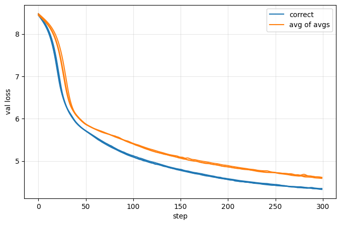
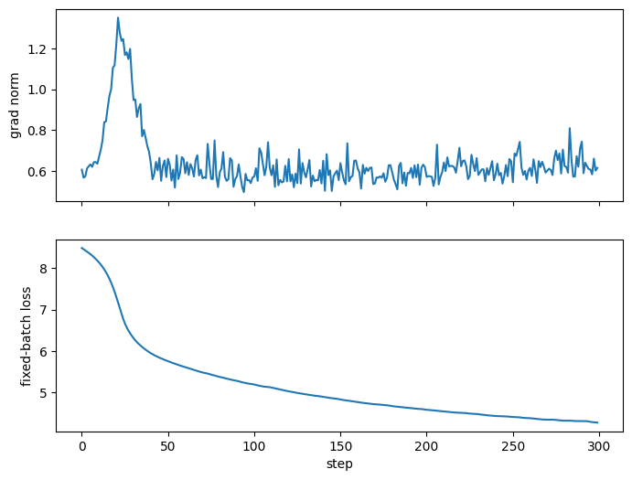

# Session 10 — Making a small model tell the truth

A 2-layer GPT (D=256, 8 heads, T=256, V=4002, about 4.2M params) on TinyStories, trained for 300 steps with AdamW at lr 3e-4.

**Hardware:** Kaggle, 2× Tesla T4; this work runs on one. **Notebook:** `session-10.ipynb`. **Plots and CSV:** `results/`.

## 1. Every tensor shape

### Keywords

| Term | Symbol | Value | Meaning |
|---|---|---|---|
| Micro-batch | B | 4 | Sequences processed together in one forward and backward pass |
| Accumulation steps | | 4 | Micro-batches whose gradients are added up before one weight update |
| Batch (effective batch) | | 16 | All sequences behind one optimizer step |
| Context length | T | 256 | Tokens per sequence |
| Model dimension | D | 256 | Numbers describing each token |
| Vocabulary size | V | 4002 | 4000 BPE tokens, plus PAD and EOS |
| Heads | H | 8 | Parallel attention units |
| Head dimension | HD | 32 | D / H, the numbers each head gets per token |
| Feed-forward dimension | DFF | 1024 | D x 4, the wider space inside SwiGLU |
| Layers | L | 2 | Transformer blocks |

### Model

```
GPT(
  (tok_emb): Embedding(4002, 256)
  (pos_emb): Embedding(256, 256)
  (blocks): ModuleList(
    (0-1): 2 x Block(
      (attn): Attention(
        (q): Linear(in_features=256, out_features=256, bias=False)
        (k): Linear(in_features=256, out_features=256, bias=False)
        (v): Linear(in_features=256, out_features=256, bias=False)
        (out): Linear(in_features=256, out_features=256, bias=False)
      )
      (n1): RMSNorm()
      (n2): RMSNorm()
      (ffn): SwiGLU(
        (gate): Linear(in_features=256, out_features=1024, bias=False)
        (up): Linear(in_features=256, out_features=1024, bias=False)
        (bottom): Linear(in_features=1024, out_features=256, bias=False)
      )
    )
  )
  (ns): RMSNorm()
  (head): Linear(in_features=256, out_features=4002, bias=False)
)
```

### One forward pass

```
inputs:
    tokens                     (4, 256)
    doc_id                     (4, 256)
    attn mask                  (4, 1, 256, 256)
    loss mask                  (4, 255)
  module outputs:
    tok_emb                    (4, 256, 256)
    pos_emb                    (256, 256)
    blocks.0.n1                (4, 256, 256)
    blocks.0.attn.q            (4, 256, 256)
    blocks.0.attn.k            (4, 256, 256)
    blocks.0.attn.v            (4, 256, 256)
    blocks.0.attn.out          (4, 256, 256)
    blocks.0.attn              (4, 256, 256)
    blocks.0.n2                (4, 256, 256)
    blocks.0.ffn.up            (4, 256, 1024)
    blocks.0.ffn.gate          (4, 256, 1024)
    blocks.0.ffn.bottom        (4, 256, 256)
    blocks.0.ffn               (4, 256, 256)
    blocks.0                   (4, 256, 256)
    blocks.1.*                 same as blocks.0.*
    ns                         (4, 256, 256)
    head                       (4, 256, 4002)
    logits (head)              (4, 256, 4002)
```

| Tensor | Shape | Dimensions |
|---|---|---|
| tokens, doc_id | (4, 256) | B, T |
| attn mask | (4, 1, 256, 256) | B, 1 (copied across H), T, T: can this token see that one? |
| loss mask | (4, 255) | B, T-1: the last token has no target |
| tok_emb | (4, 256, 256) | B, T, D |
| pos_emb | (256, 256) | T, D: no B, positions are shared by all sequences |
| n1, n2, ns, attn.q/k/v/out, ffn.bottom | (4, 256, 256) | B, T, D |
| ffn.up, ffn.gate | (4, 256, 1024) | B, T, DFF |
| head, logits | (4, 256, 4002) | B, T, V: a score for every vocab token at each position |

### What the hooks can't see

Hooks only see module outputs. These come from the T=96 micro-batch, where T can't be confused with D.

| Tensor | Shape | Dimensions |
|---|---|---|
| q, k, v after the split | (4, 8, 96, 32) | B, H, T, HD |
| attention scores, weights | (4, 8, 96, 96) | B, H, T, T: which token attends to which |
| weighted values | (4, 8, 96, 32) | B, H, T, HD |
| ctx, heads joined | (4, 96, 256) | B, T, D |
| flat logits | (380, 4002) | B x (T-1), V |
| flat targets, per-token loss | (380,) | B x (T-1) |
| loss | () | scalar, which is why `backward()` can start here |
| head.weight, its grad | (4002, 256) | V, D: a gradient has its parameter's shape |

## 2. One gradient by hand

A gradient is a slope: how much the loss moves per unit of weight. So I can measure it directly. Nudge one weight up and down, and see how the loss changes.

Weight: `head.weight[5]` = 0.01221929490566. Nudge: eps = 1e-6. Everything runs in float64.

| Step | Value |
|---|---|
| Loss at weight + eps | 8.482925586069 |
| Loss at weight - eps | 8.482925585657 |
| Loss change | 4.12e-10 |
| Slope = change / (2 x eps) | 2.064073356678e-04 |
| `backward()` gradient | 2.064077989812e-04 |
| Difference | 4.63e-10 |

They agree to 5 digits, so `backward()` is telling the truth.

**Why not fp32?** fp32 can only store fixed marks, like a ruler. Between 8 and 16 it has 8,388,608 marks, so they sit 8 / 8,388,608 = 9.5e-7 apart. The loss change is 4.12e-10, about 2,300x smaller than that gap. Both losses snap to the same mark, the change reads 0, and the measured gradient would be 0. float64's marks near 8.48 are about 1.8e-15 apart, fine enough to see the change.

## 3. Breaking gradient accumulation

Each step uses 4 micro-batches of lengths 256, 96, 32 and 8.

- **Correct:** every token counts equally.
- **Avg of avgs:** every micro-batch counts equally, so one T=8 token counts about 36x more than one T=256 token.

Both are scored on the same fixed val batch, because their logged training losses use different averages.



Val loss, averaged over steps 250 to 299:

| Seed | Correct | Avg of avgs | Gap |
|---|---|---|---|
| 0 | 4.394 | 4.675 | +0.282 |
| 1 | 4.379 | 4.669 | +0.289 |
| 2 | 4.380 | 4.650 | +0.270 |

Avg of avgs ends 0.28 higher on every seed. Changing the seed moves the correct run by only about 0.007, so the 0.28 is the bug, not luck.

**Control:** with 4 equal lengths, both methods give every token the same weight, so they should match. They do: largest difference 0.000012. So unequal lengths cause the gap.

## 4. Grad norm before loss

**Answer: step 279.** Grad norm jumps 20% while the loss is still falling. The loss goes up on the next update.

Negative loss change = loss fell.

| Step | Grad norm | Loss change | |
|---|---|---|---|
| 278 | 0.588 | -0.00380 | |
| **279** | **0.705** | **-0.00143** | **grad norm jumps, loss still falling** |
| 280 | 0.624 | +0.00068 | loss goes up |
| 281 | 0.620 | +0.00175 | loss goes up |

**How often:** rarely. After step 60, grad norm jumped 10% or more 44 times. The loss went up right after only 2 times, at steps 279 and 289.



## 5. MFU

MFU = FLOPs per second achieved / peak FLOPs per second

A FLOP is one add or one multiply operation.

### My MFU: 11.4%

FLOPs per token = 6N + 12LDT, where:

- **N = 3,121,664**, the weights used in matrix multiplies: 1,048,576 in each of the 2 blocks, plus 1,024,512 in the head.
- **6N = 18.7M.** Each weight costs 2 FLOPs forward (multiply, add). Backward costs about twice forward, a common estimate, so 4.
- **12LDT = 1.57M at T=256.** This is attention, and it grows with T. Each pass is counted at its real T.

| | |
|---|---|
| Tokens per second | 46,278 |
| Achieved | about 0.92 TFLOP/s |
| Peak, one T4, FP32 | 8.1 TFLOP/s |
| **MFU** | **11.4%** |

Kaggle gave me 2 T4s, but my code uses only the first, so the peak is for one.

### What I tested

I changed one thing at a time to see what raises MFU.

| Change | MFU | Finding |
|---|---|---|
| My run: lengths 256, 96, 32, 8, B=4 | 11.4% | Starting point |
| All sequences T=256, B=4 | 20.3% | Biggest gain |
| B=16, T=256 | 22.2% | Small gain |
| B=64, T=256 | 23.0% | Small gain |
| B=128, T=256 | 23.7% | Best I got |
| B=32, T=512 | 20.1% | Worse |
| B=16, T=1024 | 16.4% | Worse |
| B=8, T=2048 | 12.7% | Worse |

### What is costing me the distance to 40%

1. **Short sequences:** using T=256 everywhere raises MFU from 11.4% to 20.3%, the biggest gain I measured.
2. **Batch size helps a little,** then stops.
3. **Data loading isn't the problem.** At B=128, forward and backward take 99% of the time.

Time per token rises with T, with 16,384 tokens per pass:

| T | Time per token |
|---|---|
| 256 | 10.9 µs |
| 512 | 13.4 µs |
| 1024 | 18.9 µs |
| 2048 | 30.5 µs |

**Conclusion:** my run is at 11.4%. Using full T=256 sequences and B=128 brings it to 23.7%, the best I reached. The remaining gap to 40% is inside forward and backward, which take 99% of the time, and neither batch size nor sequence length closed it.

## 6. 0.1 by hand

Double 0.1 until it lands between 1 and 2:

```
0.1 -> 0.2 -> 0.4 -> 0.8 -> 1.6
```

4 doublings, so 0.1 = 1.6 x 2^-4.

- **Sign:** positive, so 0.
- **Exponent:** -4 + offset. The offset is 127 for fp32 and bf16, and 7 for fp8.
- **Mantissa:** the leading 1 is implied. Cut 1 to 2 into 2^bits slots and take the nearest slot to 1.6.

| Format | Exponent | Slots | 1.6 falls at | Nearest slot |
|---|---|---|---|---|
| fp32 | 123 | 8,388,608 | 5,033,164.8 | 5,033,165 |
| bf16 | 123 | 128 | 76.8 | 77 |
| fp8 E4M3 | 3 | 8 | 4.8 | 5 |

| Format | Sign | Exponent | Mantissa | Stored value | Error |
|---|---|---|---|---|---|
| fp32 | 0 | 01111011 | 10011001100110011001101 | 0.100000001490 | +0.0000015% |
| bf16 | 0 | 01111011 | 1001101 | 0.100097656250 | +0.098% |
| fp8 E4M3 | 0 | 0011 | 101 | 0.101562500000 | +1.56% |

Does a small update survive on a weight of 0.1?

| Format | Add 3e-4 | Add 3e-5 |
|---|---|---|
| fp32 | moves 3.000e-4 | moves 3.000e-5 |
| bf16 | moves 4.883e-4 | no change |
| fp8 E4M3 | no change | no change |

**I would train in bf16, with fp32 master weights.** bf16 has fp32's range at half the memory, but can't hold small updates, so weights stay in fp32. fp8 is out: my learning rate rounds to 0.

This run used fp32, because the T4 has no bf16 in hardware.

---

## Extra: where 2 FLOPs per weight comes from

A FLOP is one floating-point add or multiply. In a forward pass, a weight is multiplied by its input, and the result is added to the neuron's sum. That is 2 FLOPs.

As an equation, a dot product of two vectors of size p needs p multiplies and p - 1 adds, so 2p - 1 FLOPs. A running total starting at 0 runs p adds, so 2p.

For p = 3, `a · b = a1 b1 + a2 b2 + a3 b3` has 3 multiplies and 2 adds, so 5 FLOPs.

### Standard way: running total

Multiply, then add to a running total, one step at a time.

| Step | Operation | Result |
|---|---|---|
| 1 | multiply | a1 x b1 |
| 2 | add | total = 0 + a1 b1 |
| 3 | multiply | a2 x b2 |
| 4 | add | total = total + a2 b2 |
| 5 | multiply | a3 x b3 |
| 6 | add | total = total + a3 b3 |

That is 3 multiplies and 3 adds, so 2p. The first add is to 0, which is why the exact count is 2p - 1.

### FMA way

Fused multiply-add (FMA) is one instruction that does `(A x B) + C`.

| Step | Inputs | Result |
|---|---|---|
| 1 | a1, b1, 0 | total = a1 b1 + 0 |
| 2 | a2, b2, total | total = a2 b2 + total |
| 3 | a3, b3, total | total = a3 b3 + total |

That is p FMA instructions at 2 FLOPs each, so 2p.

### Conclusion

| Work | With FMA | FMA instructions | FLOPs in the calculation | FLOPs in hardware |
|---|---|---|---|---|
| Multiply only | `(A x B) + 0` | 1 | 1 | 2 |
| Multiply + add | `(A x B) + C` | 1 | 2 | 2 |

Every FMA instruction is 2 FLOPs in hardware, even when the add is +0. So one weight is 2 FLOPs: one multiply and one add.
