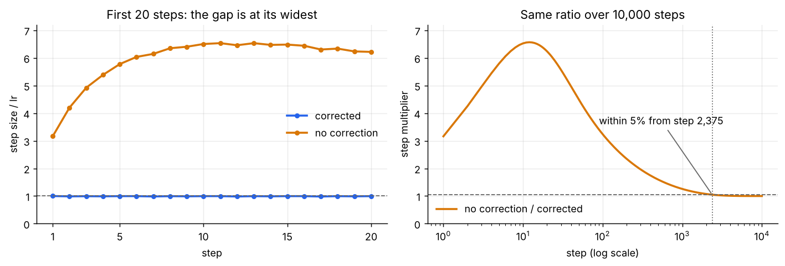
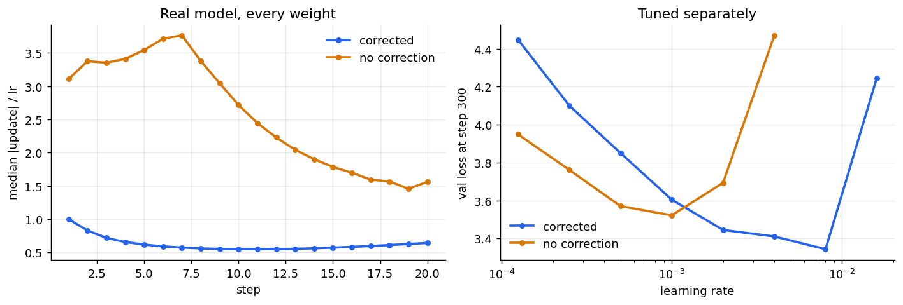
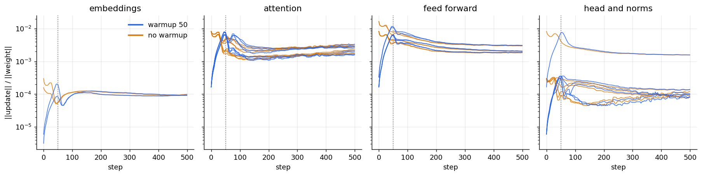
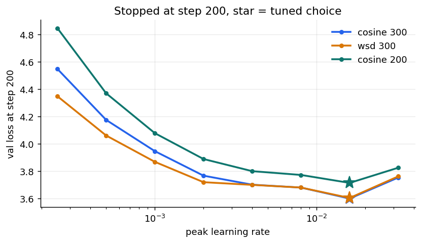
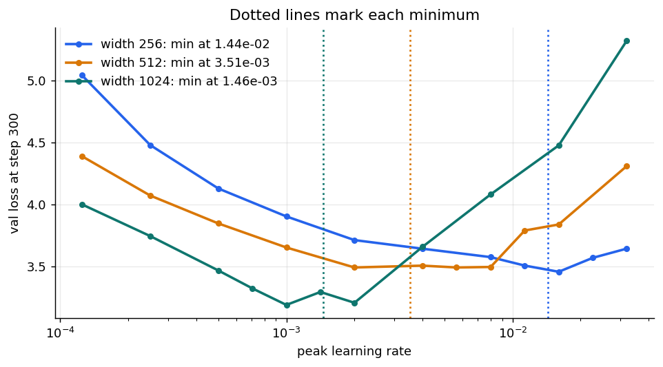

# Session 11 — Optimizers, measured

A fresh mini-GPT (2 layers, 8 heads, about 4.2M weights) trained on TinyStories, batch 32, on Kaggle. Everything is in `session-11.ipynb`, and the numbers are in `results/summary.json`.

Runs compared with each other use the same start and same batches. Each side gets its own tuned learning rate (LR).

## 1. Adam by hand

**Asked:** take one weight and five gradients, compute m, v, m_hat, v_hat and the resulting step yourself, then check each against PyTorch.

**Findings: they match at all 12 decimals shown. Largest difference 4.05e-13.**

`w = 1`, `lr = 0.001`, `β1 = 0.9`, `β2 = 0.999`, `eps = 1e-8`, gradients 0.5, 0.4, 0.6, 0.45, 0.55.

```
m     = β1·m + (1 − β1)·g
v     = β2·v + (1 − β2)·g²
m_hat = m / (1 − β1^t)
v_hat = v / (1 − β2^t)
step  = lr · m_hat / (√v_hat + eps)
w     = w − step
```

**By hand**

| t | m | v | m_hat | v_hat | step | w |
|---|---|---|---|---|---|---|
| 1 | 0.050000000000 | 0.000250000000 | 0.500000000000 | 0.250000000000 | 0.000999999980 | 0.999000000020 |
| 2 | 0.085000000000 | 0.000409750000 | 0.447368421053 | 0.204977488744 | 0.000988125782 | 0.998011874238 |
| 3 | 0.136500000000 | 0.000769340250 | 0.503690036900 | 0.256703367800 | 0.000994140047 | 0.997017734191 |
| 4 | 0.167850000000 | 0.000971070910 | 0.488077929631 | 0.243132182640 | 0.000989846693 | 0.996027887498 |
| 5 | 0.206065000000 | 0.001272599839 | 0.503198945081 | 0.255029516998 | 0.000996424711 | 0.995031462787 |

**PyTorch** (`torch.optim.Adam`, float64)

| t | m | v | m_hat | v_hat | step | w |
|---|---|---|---|---|---|---|
| 1 | 0.050000000000 | 0.000250000000 | 0.500000000000 | 0.250000000000 | 0.000999999980 | 0.999000000020 |
| 2 | 0.085000000000 | 0.000409750000 | 0.447368421053 | 0.204977488744 | 0.000988125782 | 0.998011874238 |
| 3 | 0.136500000000 | 0.000769340250 | 0.503690036900 | 0.256703367800 | 0.000994140047 | 0.997017734191 |
| 4 | 0.167850000000 | 0.000971070910 | 0.488077929631 | 0.243132182640 | 0.000989846693 | 0.996027887498 |
| 5 | 0.206065000000 | 0.001272599839 | 0.503198945081 | 0.255029516998 | 0.000996424711 | 0.995031462787 |

Both tables are copied from the output of `adam_check.py` in the notebook.

**Conclusion**

- Hand values match PyTorch at all 12 decimals shown. The largest difference printed is 4.05e-13, which is rounding.
- Every step is within 1.2% of lr, even though gradients range from 0.4 to 0.6. Gradient size barely changes the step.

## 2. Bias correction

**Asked:** turn bias correction off, plot the first twenty steps both ways, and report when the difference stops mattering.

`m` and `v` start at 0, so they read too low early on. Bias correction scales them back up. We tested this two ways.

**Learning rates used**

| Where | LR | Why |
|---|---|---|
| Fixed gradients | 0.001 | Same as Part 1. The table shows `step ÷ lr`, so lr cancels out |
| Mini-GPT, first twenty steps | 2.5e-4 | Same LR for both, so the side-by-side is fair |
| Mini-GPT, loss gap over time | 3e-4 | Same LR for both. Session 10's default, close to 2.5e-4 |
| Mini-GPT, tuned | 8e-3 with, 1e-3 without | Each side's own best LR, since one LR can favour one side |

### 1. Fixed gradients, one weight

We took one weight and gave both versions the same gradients at every step, so the only difference is bias correction.

`w = 1`, `lr = 0.001`, `β1 = 0.9`, `β2 = 0.999`, gradients 0.5, 0.4, 0.6, 0.45, 0.55, repeated to make twenty. `eps` is left out because it's too small to show here.

```
with correction:     step ÷ lr = (m / (1 − β1^t)) / √(v / (1 − β2^t))
without correction:  step ÷ lr = m / √v
```

**First twenty steps (step ÷ lr)**

| Step | With | Without |
|---|---|---|
| 1 | 1.000 | 3.162 |
| 5 | 0.996 | 5.776 |
| 10 | 0.996 | 6.505 |
| 15 | 0.996 | 6.483 |
| 20 | 0.996 | 6.219 |

**How long the gap lasts**

| Step | Step size without ÷ with | What's happening |
|---|---|---|
| 1 | 3.16× | Too big from the first step |
| 12 | 6.57× | The peak: `m` has filled up, `v` hasn't |
| 300 | 1.96× | `v` is slowly filling up |
| 2,375 | 1.05× | Within 5%, so it stops mattering |



**Conclusion:** the difference in step size stops mattering after about 2,400 steps.

### 2. Mini-GPT training

We trained separate models, one with correction and one without. Each model's gradients come from its own weights, so once their steps differ, their weights differ, and so do their gradients.

**First twenty steps (median update ÷ lr, lr 2.5e-4, 3 seeds)**

| Step | With | Without | Without ÷ with | Fixed gradients |
|---|---|---|---|---|
| 1 | 0.999 | 3.108 | 3.11× | 3.16× |
| 5 | 0.619 | 3.544 | 5.73× | 5.80× |
| 10 | 0.550 | 2.716 | 4.94× | 6.53× |
| 15 | 0.573 | 1.786 | 3.12× | 6.51× |
| 20 | 0.643 | 1.562 | 2.43× | 6.24× |

The two tests match early, then split once the models see different gradients.

**Loss gap over time (without − with, lr 3e-4)**

Negative means "without" is ahead.

| Step | Seed 0 | Seed 1 |
|---|---|---|
| 250 | −0.370 | −0.340 |
| 1,000 | −0.245 | −0.238 |
| 2,000 | −0.149 | −0.153 |
| 3,000 | −0.105 | −0.109 |

**Each side tuned (300 steps, 3 seeds)**

| | Loss at lr 2.5e-4 | Best LR | Loss at best LR |
|---|---|---|---|
| With correction | 4.100 | 0.008 | **3.344** |
| Without correction | **3.761** | 0.001 | 3.522 |

At lr 2.5e-4, "without" looks better, because its oversized early steps make up for an LR that's too low. Tuned, correction wins.



**Conclusion:** the loss difference had not closed by step 3,000. Correction lets training use a much higher LR, 8× higher here, and reach a lower loss.

## 3. Update-to-weight ratio

**Asked:** log the update-to-weight ratio for every layer, and find the step at which warmup stops changing it.

**Findings: step 120 for the median layer, step 242 for the slowest. LR stops rising at step 50.**

```
ratio = ||change in weight|| / ||weight||
```

Two runs, 50 warmup steps vs none, lr 3e-4, 500 steps, 2 seeds. Warmup is done when the two ratios stay within 10% for 20 steps in a row.

| Layer | Warmup stops changing it at step |
|---|---|
| `ffn.up`, `ffn.gate` | 59–60 |
| `head` | 90 |
| `ns.g`, `pos_emb`, `tok_emb`, attention | 109–127 |
| `n1.g` | 136–140 |
| `ffn.bottom` | 189–191 |
| `n2.g` | 233–242 |

The ratio peaks around step 45, before warmup ends. Warmup's effect lasts about 70 steps past its end for the median layer.



## 4. Cosine vs WSD, stopped at step 200

**Asked:** train the same model twice for 300 steps, once under cosine and once under WSD, stop both at step 200, report both losses, and say which you'd keep.

**Findings: cosine 3.600, WSD 3.604. It's a tie, and I would keep WSD.**

Both tuned, peak LR 0.016, 3 seeds.

| | Loss at step 200 | After 30-step cooldown |
|---|---|---|
| Cosine | 3.600 ± 0.048 | 3.535 |
| WSD | 3.604 ± 0.049 | **3.464** |

At step 200 the seeds disagree on which is ahead. I keep WSD because a short cooldown then beats cosine on all three seeds, by 0.07. The cooldown was my addition.

Untuned at lr 2.5e-4, WSD looked 0.20 better. Tuning removed that gap.



## 5. Learning rate against width

**Asked:** sweep LR at widths 256, 512 and 1,024, plot loss against LR, mark the minima, and give the value for width 4,096 with your confidence.

**Findings: 2e-4, low confidence.**

| Width | Minimum | From the plot |
|---|---|---|
| 256 | 1.44e-02 | clear |
| 512 | 3.51e-03 | flat from 2e-3 to 8e-3 |
| 1,024 | 1.46e-03 | sits on a bump, unreliable |



The fitted line gives 1.4e-04 at 4,096. Plain 1/width from 1,024 gives 3.7e-4. I picked about the middle, so 2e-4 is my call, not a measurement.

Confidence is low because two of the three minima are soft, the fit missed width 1,024 by 1.7× when tested on it, and 4,096 was never run. I'd sweep 1e-4 to 4e-4 there first.

## Limits

These are short runs, so they describe early training. Only LR was tuned, and three seeds catch only large effects.
